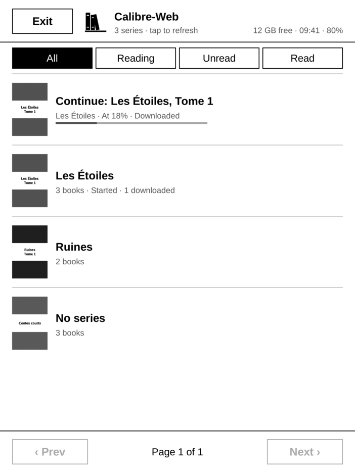
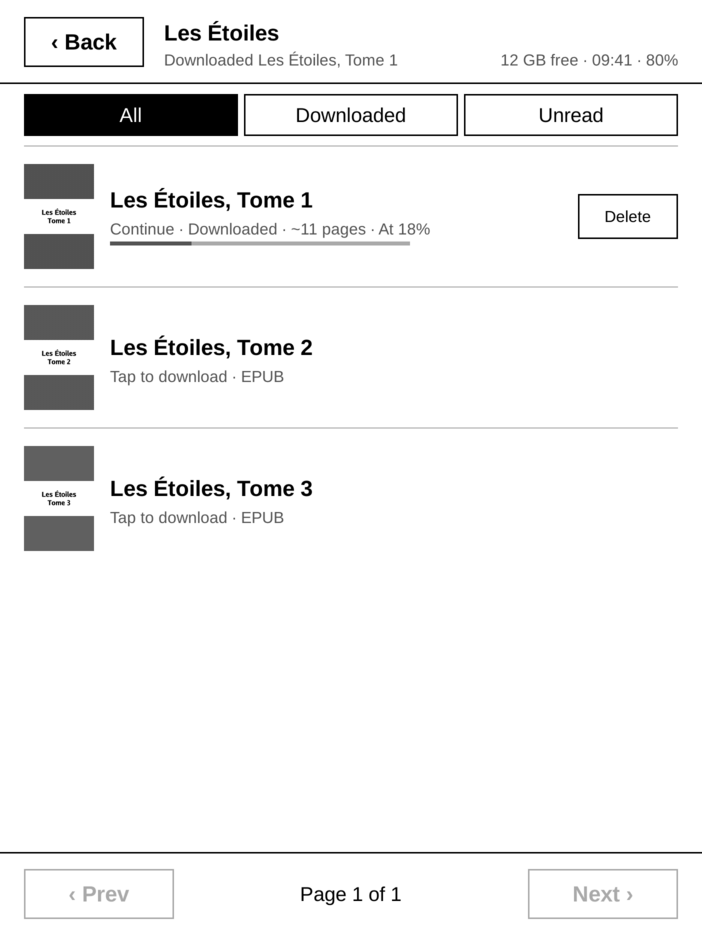
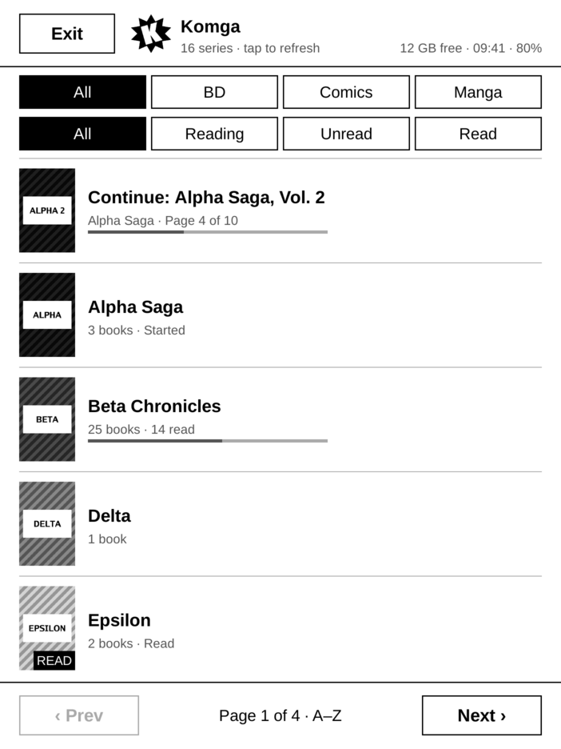

# Inkshelf

An e-reader app for PocketBook e-ink readers (InkPad 3), written in pure Go, that reads EPUB
books, comics and manga (CBZ) and recipes from your self-hosted [Komga](https://komga.org),
[Calibre-Web](https://github.com/janeczku/calibre-web) and [Mealie](https://mealie.io) servers.

This is a fun project: I wrote it to discover how EPUBs are handled (XHTML, CSS, line breaking,
pagination, fonts…) and how a PocketBook works under the hood (framebuffer, e-ink refresh,
firmware). I also plan to port it to Kobo and Kindle readers, just to understand how they work.

I also wanted to see whether a PocketBook app could do without the official SDK: no cgo, no
libinkview, just Go drawing into the framebuffer and talking to the firmware itself. It can.

It was written with [Claude Code](https://claude.com/claude-code), but I still tried to keep the
code intelligible and easy to read: the goal is to learn, not to offer a production app. If you
want a solid, mature reader, use [KOReader](https://github.com/koreader/koreader).

  
  
  
  
  

Screenshots from the emulator, with fake servers; the book being read is Project Gutenberg's
<i>Alice's Adventures in Wonderland</i>.

## Using it

You're welcome to use it. Download the zip of the
[latest release](https://github.com/CedricHerzog/inkshelf/releases/latest), connect the reader
over USB, unzip it at the root of the reader, then write `applications/inkshelf/config.json`
with your servers. How to configure it, or build it from source, is in
[docs/reference/usage.md](docs/reference/usage.md); how it works inside starts at
[docs/reference/architecture.md](docs/reference/architecture.md).

To learn how it works from scratch, with animations of e-ink refreshes, dithering, EPUB
layout and the app's threads, read [the documentation site](https://cedricherzog.github.io/inkshelf/)
(or run `make docs` and open http://localhost:3000/inkshelf/): the
[learning chapters](docs/learn) go from the big picture down to the algorithms.

## Working in a container

[.devcontainer](.devcontainer) holds everything `make verify`, `make icons` and `make docs` need,
and Claude Code: open the folder in VS Code and choose *Reopen in Container*. Its firewall lets
through only Anthropic's API, GitHub, the Go proxy and npm. To run `make emu` against your own
servers, list their hosts, space-separated, in `INKSHELF_ALLOWED_DOMAINS` on the host before you
open it. `make deploy` needs the reader mounted over USB, so it runs on the host.

## Maintenance

I don't maintain it on a regular basis, only when I feel like it. Pull requests are welcome,
and so are forks.

## License

[GNU Affero General Public License v3.0](LICENSE).
