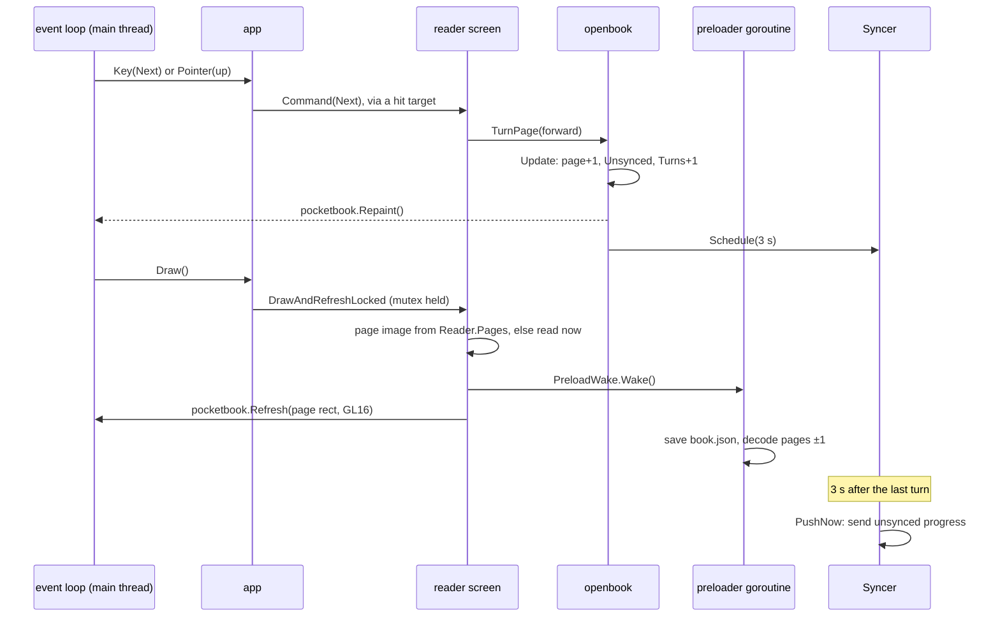
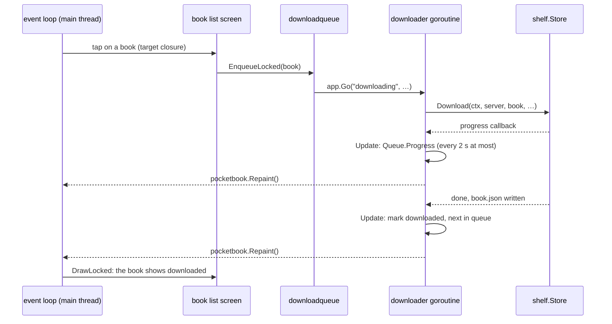

# App threading

The app ([internal/app](../../internal/app)) draws on one goroutine and does slow work on others.
This page explains how they share the app's state without races, and why a tap never waits for
the network. The package docs of [app](../../internal/app) and [app/state](../../internal/app/state)
say the same in short.

## The main thread

[device/pocketbook](../../internal/device/pocketbook)'s `Run` calls the app (`Init`, `Draw`, `Key`,
`Pointer`, `System`, `Close`) from one goroutine, its event loop. We call it the main thread.
Drawing happens there, and so does whatever a tap or a button does.

Other goroutines never call the app or draw. They ask the event loop for things through
`pocketbook.Repaint`, `pocketbook.Exit` and `pocketbook.PreventSleepFor`, which only queue a
request: the event loop acts on it between two calls to the app.

## The state and its mutex

Everything the app knows while it runs is in one `state.State`
([app/state](../../internal/app/state)): the screen shown, the lists, the open book, the download
queue, the covers. Its first group of fields is guarded by one mutex. Its comments say which
other fields are read-only once the goroutines run, or touched by the main thread only.

A goroutine changes the state with `Update(fullRefresh, change)`:

1. `Update` takes the mutex and runs `change`.
2. If `change` returns true (something visible changed), `Update` asks for a repaint with
   `pocketbook.Repaint`, a full refresh (with a flash) if `fullRefresh` is set. Several updates
   before the next `Draw` make one repaint.
3. The event loop then calls `Draw`, which takes the mutex and draws the screen shown.

`Draw` refreshes the whole panel when `fullRefresh` was asked for, or when the draw did not come
from `Update` (the app starting, or coming back to the foreground: the panel may show anything).
Otherwise it does a partial refresh.

### The Locked suffix

A function whose name ends in `Locked` runs with the state's mutex held and never takes it
itself. Calling it without the mutex is a race; taking the mutex inside it is a deadlock. Keep
the suffix when you add one. The `DrawLocked` of every screen, and everything it calls, runs with
the mutex held.

## Screens, targets and commands

Each screen is a package under [app/screens](../../internal/app/screens). It implements `Screen`
(`internal/app/screens.go`):

- `DrawLocked()` draws the whole screen into the canvas and registers its targets.
- `Command(widgets.Command)` does what a button asks: `Previous`, `Next`, `Back` or `Menu`. It
  runs without the mutex.

A screen may also implement optional interfaces, which `app` checks with a type assertion:

| Interface | Who | What it changes |
|---|---|---|
| `selfRefreshing` | the reader | refreshes only the part of the panel that changed, instead of the whole screen |
| `swipeable` | the lists, the contents | a swipe sideways turns the list's pages |
| `touchable` | the reader, the cover view | the screen decides what each touch does, instead of hit-testing its targets |
| `overlaid` | the lists | any tap or button first closes the hold menu or the A–Z jump |

A **target** (`widgets.Target`) is a rectangle and closures: `Tap`, `Hold`, or a `Command`. A
screen registers its targets while it draws them, so they always match what the panel shows.
When a touch ends, `app` hit-tests the targets with the mutex held, releases it, then runs the
closure. The closure takes the mutex itself, through `Update`. That is why a closure must never
be called with the mutex held.

Screens never import each other. A screen moves to another with `state.ShowLocked(ScreenID)`,
and leaves to the services what other screens must see: the reader closing a book tells
[app/catalog](../../internal/app/catalog) its progress, which the book list then shows.

## Services

The services are functions over `*state.State` that do the app's work, shared by the screens:

| Package | Job |
|---|---|
| [app/session](../../internal/app/session) | read config.json, choose the server, open its folder, load the series or fall back to the downloaded books, showing them first while the Wi-Fi turns on; makes the `progress.Syncer` |
| [app/catalog](../../internal/app/catalog) | the series and book lists, their counts and filters |
| [app/downloadqueue](../../internal/app/downloadqueue) | the download queue and its downloader goroutine |
| [app/covers](../../internal/app/covers) | loading the small covers, and the whole-screen one |
| [app/openbook](../../internal/app/openbook) | opening, turning, preloading and closing the open book |

## Starting goroutines

Only the main thread starts goroutines, through the state:

- `app.Go(name, task)` runs a one-off task: loading the session, a download, fetching a series'
  books. It counts as background work named `name` while it runs.
- `app.GoLoop(task)` runs a goroutine that lives until the app closes, waiting to be woken: the
  page preloader (`openbook.Preloader`) and the cover loader (`covers.Loader`).
- A `state.Wakeup` wakes such a goroutine. `Wake` never blocks and holds one wake-up at most, so a
  busy goroutine runs once more, not once per call. Each wake-up counts as background work until
  the goroutine calls `Done`. Drawing the reader wakes the preloader; drawing a list wakes the
  cover loader with the covers it lacked.

`Close` cancels `app.Ctx` and waits for every goroutine started this way, so none outlives the
app.

The background work counter (`state.Work`) is never read by the app. The emulator reads it
(`App.BackgroundWork`) so that a script's screenshot waits for the work the last tap started,
instead of guessing how long it takes. See [emulator.md](emulator.md).

## Lock order

Three locks exist, always taken in this order, never the other way round:

1. The `progress.Syncer`'s lock, while it sends progress to the server. It takes the state's
   mutex for short moments. So never call the Syncer with the state's mutex held.
2. The state's mutex.
3. The lock inside a `reading.TextBook` (its renderer), while it lays out or draws a page of an
   EPUB. Code holding the state's mutex may draw a page; the renderer never calls back into the
   app.

The preloader draws the next pages of an EPUB without the state's mutex (it takes only the
renderer's), so a tap is never stuck behind a slow layout.

## A page turn

## A background update: a download finishing

