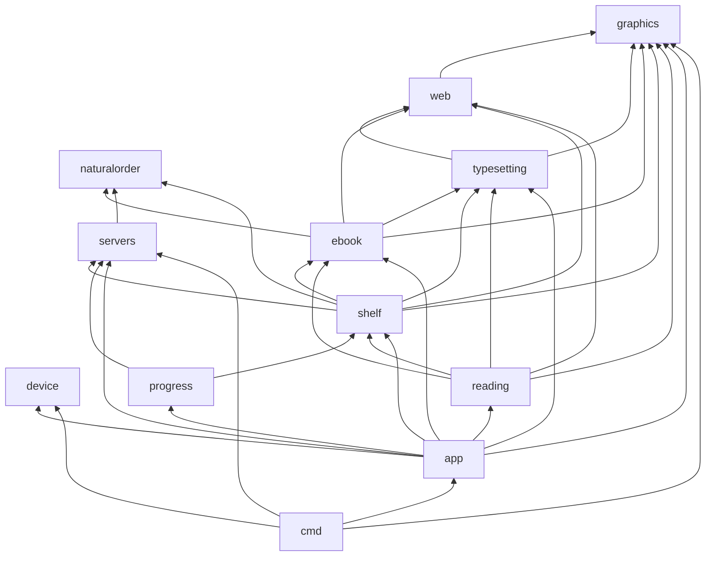

# Architecture

Inkshelf is one Go module. Everything but the two programs in [cmd](../../cmd) lives under
[internal](../../internal), in folders named after a domain: what you need to know to work there.
This page is the map. Each package's own documentation (`go doc ./internal/...`, or its
`doc.go`) explains its domain in more depth. New to all this? The learning
chapters of this site (`docs/learn`, `make docs`) explain the same domains from scratch, with
interactive animations.

## The domains, bottom to top

| Domain | Packages | What it knows |
|---|---|---|
| device | [device/pocketbook](../../internal/device/pocketbook) | The PocketBook reader without its SDK: framebuffer, e-ink refreshes, firmware messages, input, the event loop, Wi-Fi, and an emulated reader for the host. |
| device | [device/pocketbook/script](../../internal/device/pocketbook/script) | Scripts of taps, buttons, waits and shots, parsed and run against the emulator. |
| graphics | [graphics/fonts](../../internal/graphics/fonts), [graphics/pageimage](../../internal/graphics/pageimage) | Pixels: TrueType fonts, shaping and drawing text in gray; page images decoded, fitted, toned, dithered to 16 grays and packed into `.pg4` files. |
| web | [web/css](../../internal/web/css), [web/svgimage](../../internal/web/svgimage), [web/mathml](../../internal/web/mathml), [web/webfont](../../internal/web/webfont), [web/webimage](../../internal/web/webimage), [web/uri](../../internal/web/uri) | The web formats books are written in: the CSS cascade, SVG, MathML, WOFF fonts, a book's images, relative links and data: URIs. |
| typesetting | [typesetting/document](../../internal/typesetting/document), [typesetting/layout](../../internal/typesetting/layout), [typesetting/hyphen](../../internal/typesetting/hyphen) | Text on pages: the document model (blocks of styled runs), line breaking, bidi, justification, floats, tables, pagination, hyphenation. |
| ebook | [ebook/epub/container](../../internal/ebook/epub/container), [ebook/epub](../../internal/ebook/epub), [ebook/fixedlayout](../../internal/ebook/fixedlayout), [ebook/comicarchive](../../internal/ebook/comicarchive) | Book files: an EPUB's zip, package and navigation; its XHTML and CSS turned into documents; fixed-layout pages; the pages of a CBZ. |
| (utility) | [naturalorder](../../internal/naturalorder) | "Tome 2" before "Tome 10". Imports nothing; used by ebook, servers and shelf. |
| (utility) | [timing](../../internal/timing) | Spans for the log and the execution trace, and profile captures. Imports nothing of Inkshelf's; any domain may use it. See [profiling.md](profiling.md). |
| servers | [servers](../../internal/servers), [servers/komga](../../internal/servers/komga), [servers/mealie](../../internal/servers/mealie), [servers/calibreweb](../../internal/servers/calibreweb), [servers/httpclient](../../internal/servers/httpclient), [servers/registry](../../internal/servers/registry), their fakes, [servers/servertest](../../internal/servers/servertest) | What the app needs from a server of books (the `Server` interface and its neutral model), and one package per kind of server. See [servers.md](servers.md). |
| shelf | [shelf](../../internal/shelf) | The books downloaded on the reader: downloading them, preparing them for the panel, `book.json`, covers. See [on-disk-formats.md](on-disk-formats.md). |
| progress | [progress](../../internal/progress) | Keeping the reading progress of the reader and the server in agreement. See [progress-sync.md](progress-sync.md). |
| reading | [reading](../../internal/reading) | The engine behind reading an EPUB whose text flows: positions, page turns across chapters, links and notes, the table of contents. |
| app | [app](../../internal/app) and below | The user interface: state, widgets, services, screens. See [app-threading.md](app-threading.md). |
| cmd | [cmd/inkshelf](../../cmd/inkshelf), [cmd/emulator](../../cmd/emulator) | The program for the reader, and the emulator for the host. See [emulator.md](emulator.md). |

## The layering rule

A package imports only from its own domain or from domains below it in the table. Two more
rules keep the app independent of any one server:

- `app` and `shelf` (and everything they import) never import a specific server
  (`servers/komga`, `servers/mealie`, `servers/calibreweb`). They talk to `servers.Server`.
  Only the programs in `cmd` import `servers/registry`, which knows every kind.
- The reader side (device, graphics, web, typesetting, ebook) knows nothing of servers.

Check the first rule with:

```sh
go list -deps ./internal/app/... ./internal/shelf | grep -E 'servers/(komga|mealie|calibreweb)'
```

It must print nothing.

The imports between domains, from `go list -f '{{.ImportPath}}: {{join .Imports " "}}' ./...`:



`timing` is left out of the graph to keep it readable: device, graphics, ebook, servers, shelf,
reading, app and cmd use it, to time their work for the log and the trace.

## Where do I look for…

| Question | Where |
|---|---|
| What happens on a page turn | [app/openbook](../../internal/app/openbook) `TurnPage`, then the reader screen's `DrawAndRefreshLocked` in [app/screens/reader](../../internal/app/screens/reader); sequence in [app-threading.md](app-threading.md) |
| A panel refresh, waveforms, ghosting | [device/pocketbook](../../internal/device/pocketbook) (`Refresh`, `FlashRefresh`, `eink_refresh.go`); [eink-and-firmware.md](eink-and-firmware.md) |
| Talking to the firmware, input, the event loop | [device/pocketbook](../../internal/device/pocketbook); [eink-and-firmware.md](eink-and-firmware.md) |
| A download | [app/downloadqueue](../../internal/app/downloadqueue) (the queue), [shelf](../../internal/shelf) `Store.Download` (the work); [image-pipeline.md](image-pipeline.md) |
| How a page image is prepared | [graphics/pageimage](../../internal/graphics/pageimage); [image-pipeline.md](image-pipeline.md) |
| A CSS property in a book | [ebook/epub](../../internal/ebook/epub) (`computeStyle` and the builder), [web/css](../../internal/web/css) (parsing, cascade); [epub-to-page.md](epub-to-page.md) |
| What a chapter becomes | [typesetting/document](../../internal/typesetting/document); [document-model.md](document-model.md) |
| Line breaking, justification, pagination | [typesetting/layout](../../internal/typesetting/layout); [pagination.md](pagination.md) |
| Fonts, fallbacks, Arabic shaping | [graphics/fonts](../../internal/graphics/fonts) |
| How much of EPUB 3.3 works | [epub-conformance.md](epub-conformance.md) |
| A server's API | [servers/komga](../../internal/servers/komga), [servers/mealie](../../internal/servers/mealie), [servers/calibreweb](../../internal/servers/calibreweb); [servers.md](servers.md) |
| Adding a kind of server | [servers.md](servers.md), the checklist at the end |
| Progress sync | [progress](../../internal/progress), the calls in [app/openbook](../../internal/app/openbook) and [app/catalog](../../internal/app/catalog); [progress-sync.md](progress-sync.md) |
| A screen | [app/screens](../../internal/app/screens): one package per screen; `app/screens.go` for the `Screen` interface |
| Locks, goroutines, repaints | [app/state](../../internal/app/state); [app-threading.md](app-threading.md) |
| Files on the reader | [shelf](../../internal/shelf), [app/session](../../internal/app/session), [cmd/inkshelf](../../cmd/inkshelf); [on-disk-formats.md](on-disk-formats.md) |
| The emulator, scripts and screenshots | [cmd/emulator](../../cmd/emulator), [emulator/scripts](../../emulator/scripts); [emulator.md](emulator.md) |
