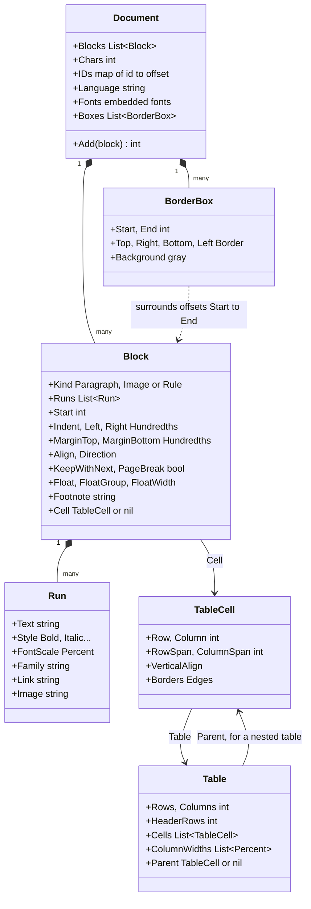

# The document model

[internal/typesetting/document](../../internal/typesetting/document) is the bridge between the
EPUB reader and the typesetter. Package `epub` turns a chapter's XHTML and CSS into a
`Document`; package `layout` turns a `Document` into pages. The model keeps only what layout
needs, already worked out, so `layout` knows nothing of HTML or CSS, and `epub` knows nothing
of pixels.

If you know HTML, think of the model as a *flattened* page: block elements become a flat list
of blocks, inline elements become runs of styled text inside a block. What does not fit a flat
list (tables, borders, floats) is described *around* it.

## Document, Block, Run

A **Document** is one chapter: a list of `Block`s, plus what applies to all of them (the
language, for hyphenation; the fonts the chapter embeds; the anchors that links lead to, in
`IDs`).

A **Block** is something that stacks down the page: a paragraph or heading (`Paragraph`), an
image on its own lines (`Image`), or a horizontal rule (`Rule`). It carries everything about its
box: margins, first-line indent, alignment, direction, line height, whether to hyphenate,
whether to stay on the same page as the next block (`KeepWithNext`, for headings).

A **Run** is text in one style inside a block: bold, italic, a size relative to the block
(`FontScale`), a font family, a link target, a gray. `<em>`, `<a>` and `` become runs.
A run with `Image` set is an **inline image** (a small picture in a line of text, or a formula,
see [epub-to-page.md](epub-to-page.md#formulas)); its `Text` is empty.

## Offsets: where things are

Positions in a document are **rune offsets**: a count of characters (Go's runes, not bytes)
from the start of the chapter. Each block's text counts its runes, spaces included; an image
block, a rule and an inline image each count as **one**. `Document.Add` sets each block's
`Start` and grows `Chars`.

Offsets are fixed when the document is built and never depend on layout. That is the key to
the whole reader: a reading position, a table-of-contents entry, a link target and a border
box's extent are all offsets, so they survive a change of font size or screen. Every laid-out
`Page` and `Line` knows the offsets it shows (`Start`, `End`).

## Units

Lengths are kept in units that scale with the reader's choices, not in pixels:

| Unit | Meaning | Used for |
|---|---|---|
| `Hundredths` | hundredths of an em: 150 is 1.5 em | margins, indents, padding, letter spacing, border widths |
| `Percent` | 100 is the whole | font scales, image and float widths, column widths |
| `Pixels` | screen pixels | only in `layout.Settings` and laid-out pages |

All three are aliases of `int`: they cost nothing and only document what a field counts.
Because margins are in ems, they grow when the reader picks a larger font, as in a browser.
Layout converts them to pixels at the reader's font size (`Settings.em`).

## Border boxes

In CSS a `
` with a border or a background draws a box around everything inside it, which
may be many blocks. The model keeps the blocks flat and lists boxes on the side: a
**BorderBox** draws its borders and background around the blocks from offset `Start` to `End`.
Boxes nest (`Document.Boxes` is ordered by `Start`, the outer box first). The blocks inside
already have their `Left` and `Right` widened to make room for the borders and padding.

Layout draws a box under its text and splits it at page breaks: see
[pagination.md](pagination.md#border-boxes-across-pages).

## Floats

A CSS `float` takes an element out of the text and pushes it to the left or right, the text
flowing around it: a picture with its caption, a sidebar, a drop cap. In the model, the blocks
of one floated element share a `FloatGroup` number and a `Float` side, and optionally a
`FloatWidth`. `Clear` on a later block starts it below the floats. Layout lays a group out
apart and places it beside the following text.

## Tables

A **Table** is a grid of **TableCell**s, each at a row and column, possibly spanning several.
The cells' content is ordinary blocks: they follow one another in the document, cell after
cell, row after row, and each points to its cell through `Block.Cell`. Layout finds the
consecutive blocks of one table (the paginator's `tableOf`) and places them as a grid.

A table inside a cell points to that cell with `Table.Parent`. `HeaderRows` are repeated at the
top of each page the table continues on. `MaxTableColumns` and `MaxTableRowSpan` cap what a
broken book can ask for.

## Footnotes

Books mark notes with `epub:type="footnote"`, or just put a note somewhere with a link back to
its call. Package `epub` recognizes both (`notes.go`) and sets `Block.Footnote` to the note's id
on each of its blocks. With `layout.Settings.HideFootnotes`, layout leaves out the notes that a
link in the same chapter leads to: the reader shows them in a popup when their call is tapped.
Hidden blocks keep their offsets, so positions mean the same text either way. Notes linked from
other chapters (endnotes) stay in the text.

## Scripts

`Document.Add` also scans each block's text once (`ScanScripts`) and records in `Block.Scripts`
whether it holds Chinese or Japanese (lines break between characters), right-to-left text
(bidirectional levels) or a script that needs shaping. Layout then skips the costly Unicode
algorithms for the vast majority of blocks, which are plain Latin text.
