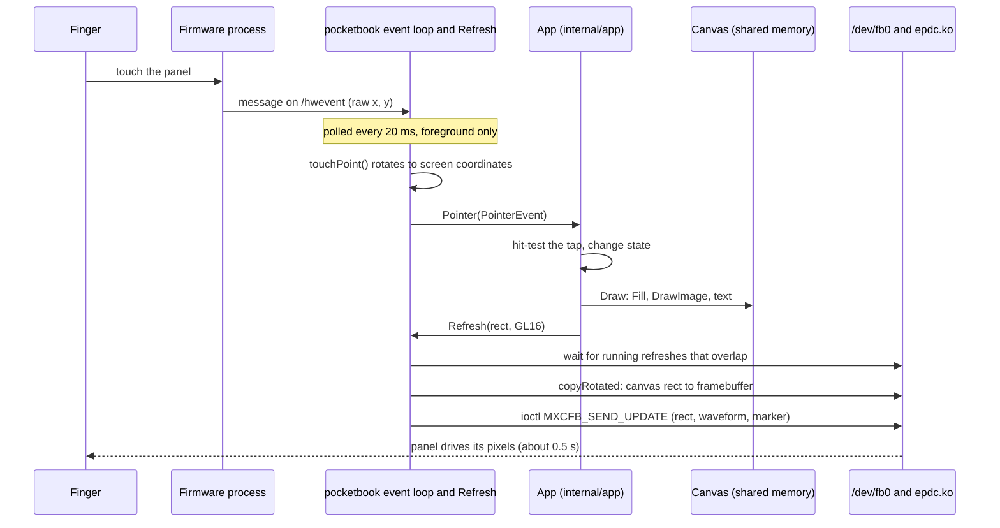

# E-ink and the firmware

Inkshelf runs on a PocketBook InkPad 3 (firmware 6.x) without PocketBook's SDK. The SDK's C
library, libinkview, normally draws the screen, reads the buttons and talks to the firmware.
Using it would need cgo and a cross-compiler for ARM. Instead,
[internal/device/pocketbook](../../internal/device/pocketbook) does the same work in pure Go, so
`make build` is a plain `GOOS=linux GOARCH=arm` build. Everything below was learned by
disassembling libinkview and by running small probe programs on the reader.

This page explains the concepts. The package documentation and the comments next to each
constant give the exact byte offsets.

## The task model

The firmware is a process called `pocketbook`, running as root. It launches every app as a
*task* and knows it by its process group id (pgid). For each task it creates
`/var/run/task/<pgid>/`, holding among other things the key of the task's canvas (see below).
Apps run as an unprivileged user: they can write `/dev/fb0` but cannot read `/dev/input/*`,
so all input comes through the firmware.

Several apps can be open at once. Only one is in the *foreground*: it alone may draw on the
panel and read input. Pressing Home moves another task to the foreground; the task switcher
may later stop a background app with SIGINT, which `Run` catches so the app can save its
state.

## Three channels to the firmware

The firmware shares three inter-process communication objects with apps
(`firmware_shared_memory.go`, `firmware_messages.go`):

| Channel | Kind | What it carries |
|---|---|---|
| Global state | System V shared memory, key `0xa12302` | The foreground task's pgid, whether refreshes are suppressed, battery percent, charging |
| `/hwevent` | POSIX message queue | Input: 32-byte messages for key presses and releases, touches down, move and up |
| Task queue | System V message queue, key `0xa1230f` | Events for a task (foreground, background, exit, network up/down, USB storage) and requests to the firmware with their replies |

`/hwevent` is shared by every app, so an app must read it only while it is in the
foreground, or it steals another app's input.

Requests go out on the task queue with an id built from the app's pid and a serial number.
The reply comes back on the same queue tagged with that id, and it **must** be read, or it
stays in the queue forever. The only request the app sends today is "don't sleep for N
seconds" (`PreventSleepFor`, libinkview's `BanSleep`), used during downloads.

Some events need an answer: a *sync* event (type `0x513`) makes the firmware wait for a reply
before it goes on. The event loop sends it at once.

## The canvas and the framebuffer

A *framebuffer* is memory whose bytes are the screen's pixels. Here it is `/dev/fb0`, one byte
per pixel (0 black, 255 white), mapped into the app's memory.

The app never draws into the framebuffer directly. It draws into a *canvas*: a 1404×1872 gray
image in a shared memory segment the firmware gives each task (so the task switcher can show
a thumbnail). Drawing functions such as `Fill` and `DrawImage` work on the canvas
(`canvas.go`). Nothing appears until the app calls `Refresh`.

### Rotation

The panel is mounted turned a quarter. The framebuffer is landscape (1872×1404), the app works
in portrait (1404×1872). Screen pixel (x, y) is framebuffer column y, row 1403 − x. So a
refresh copies the changed rectangle *and rotates it*: a canvas row becomes a framebuffer
column.

Framebuffer memory is slow to write, and Go on 32-bit ARM never merges byte stores into word
stores. `copyRotated` (`framebuffer_copy.go`) therefore works in 32-pixel tiles of 4×4 blocks
and writes whole 32-bit words. It takes about 22 ms per page turn, against 48 ms byte by byte.
It is a hot path: see [image-pipeline.md](image-pipeline.md#hot-paths).

### Dark mode

The firmware's dark mode (6.8 and later) shows its screens white on black. The app draws black
on white as always, then inverts what must show dark before the refresh (`widgets.Show`, with
`Invert` in `canvas.go`): every screen in dark mode (`application.Draw`), and in the reader the
page with its toolbar, popup and end panel when the page is dark (`openbook.DarkPageLocked`: text
by default, a series' choice in the toolbar's bottom bar). A light page is not inverted at all. Covers keep their colors
by being drawn in negative (`widgets.Picture`), which the screen's inversion turns back. The
canvas therefore always holds what the panel shows, and the copy to the framebuffer does not
change. The driver's own inversion flag (`EPDC_FLAG_ENABLE_INVERSION` in `mxcfb.h`) is not
used: it would invert everything, and KOReader found that it does not work on the B288
(koreader#6669), so it inverts in software too. A dark page turns with GC16 instead of GL16: GL16
is tuned for a white background and flashes the refreshed area white on a black one, where GC16
flashes it black. KOReader's night mode on PocketBook does the same (`waveform_night` is GC16).

The setting is read when the app starts and each time it comes back to the foreground
(`followDarkMode`, `dark_mode.go`): it is changed in the settings app, which sends Inkshelf to
the background, and a change redraws the whole panel. On
the reader it is `screen_mode_inverted` in `/mnt/ext1/system/config/global.cfg` (`key=value`
lines, `firmware_settings.go`), 1 in dark mode. The firmware does not document it: it was found
by switching dark mode on the reader and comparing the settings. `night_mode`, next to it, stays
1 either way; `invert_illustrations` is the firmware's own option for pictures in dark mode.
If the file cannot be read or lacks the setting (an older firmware, or a file read while the
firmware rewrites it), the last value stays. The log says what was found when that changes.

## E-ink refreshes and waveforms

An e-ink pixel is a tiny capsule of black and white particles moved by an electric field.
Changing it means driving it with a sequence of voltages over many frames: a *waveform*.
The panel's driver (`epdc.ko`) offers the MXCFB ioctls of NXP's i.MX6 e-ink driver on
`/dev/fb0`, although the InkPad 3 uses an Allwinner chip:

- `MXCFB_SEND_UPDATE` (`0x4040462e`) starts a refresh of a rectangle with a waveform, as a
  partial or full update, tagged with a *marker* number. It returns at once.
- `MXCFB_WAIT_FOR_UPDATE_COMPLETE` (`0x4004462f`) waits for the refresh with a marker to end.

The waveforms (`Waveform` in `eink_refresh.go`), with times measured on an InkPad 3:

| Waveform | Grays | Use | Time |
|---|---|---|---|
| GC16 | 16 | Cleanest; drives every pixel. As a *full* update it flashes black then white | full ≈ 600 ms, partial ≈ 490 ms |
| GL16 | 16 | Only drives pixels that change; tuned for text on white, flickers less | partial ≈ 490 ms |
| DU | 2 (black, white) | Fast feedback | ≈ 265 ms |
| A2 | 2 | Fastest, most ghosting | not measured |
| GC4, DU4 | 4 | Rarely useful for manga or books | not measured |

A refresh takes (waveform frames) ÷ (frame rate): GC16 is about 49 frames at about 85 Hz. On
top of that, sending the ioctl costs 14–22 ms per page turn.

### Ghosting, partial and full refreshes

A partial refresh only drives the pixels that change, and leaves faint traces of the previous
image: *ghosting*. A full GC16 refresh (`FlashRefresh`) flashes the screen and clears it. The
app does a partial GL16 refresh on most page turns and a full one every few turns (more often
for comics than for text, which ghosts less), and a full one when it comes back to the
foreground.

`readerFirmware.flush` (`framebuffer_linux_arm.go`) remembers the last few refreshes and waits
only for those still running that overlap the new rectangle, so refreshes of different areas go
on in parallel. It logs its wait,
copy and send times to `applications/inkshelf.log`: that is how page turns are timed.

`visible()` checks the global state before every refresh: an app in the background, or while
the firmware suppresses refreshes, must not touch the panel.

## The event loop

`Run` (`app.go`) calls the app (`Init`, `Draw`, `Key`, `Pointer`, `System`, `Close`) from one
goroutine only. Every 20 ms, like libinkview, the loop (`event_loop.go`):

1. reads the task queue, answers sync events, passes system events to `App.System`;
2. checks the foreground; coming back, it calls `Draw`, since the panel shows another app;
3. reads `/hwevent` (foreground only) and turns raw input into the app's events;
4. reads replies to its requests.

The firmware only sends key press/release and touch down/move/up. Like libinkview, the loop
makes the rest itself: key repeats (`keys.go`), long presses, holds and drags (`touch.go`). A
touch counts as still while it stays within a dead zone of R² = 200 px of where it went down.

Other goroutines (downloads, cover loading) never call the app. They call `Repaint`, `Exit` or
`PreventSleepFor`, which only queue a request on a channel that the loop reads.

### Touch coordinates

The touch panel is also mounted turned. Raw touches are converted by `touchPoint`: screen
x = raw y, screen y = 1871 − raw x. The InkPad 3 has no `tsc.dat` calibration file, so this
fixed mapping is all there is.

## From a touch to a refreshed panel

## Wi-Fi and sleep

Wi-Fi is turned on by running the firmware's own tool, `/ebrmain/bin/netagent net on`, as
libinkview's `NetConnect` does (`wifi_linux_arm.go`, `KeepWiFiOn`). It also fills
`/etc/resolv.conf`, so Go's own DNS resolver works. `KeepWiFiOn` gives up after 40 s; the
processes netagent starts outlive it when it is killed and hold its output open, so the wait for
that output is bounded too (`WaitDelay`). The app does not wait for it to show the downloaded
books: `session.Load` shows them first when the reader is not connected yet.

The reader falls asleep after a few minutes without input. A download would be cut short, so
the app calls `PreventSleepFor` while it works.

## The emulator

All of the above is behind one small interface, `firmware` (`firmware.go`): flush a rectangle,
report visibility, read the next input or task message, send a message, read the battery and
the dark mode setting.

- `readerFirmware` talks to the real firmware. It lives in files ending in `_linux_arm.go`,
  built only for the reader; `firmware_other.go` makes `Run` fail elsewhere.
- `Emulator` (`emulated_firmware.go`) does it in memory. Its panel is an image that only
  changes on a refresh, rounded to 16 grays, so an area drawn but never refreshed stays
  stale, as on the reader. With `-eink`, refreshes take as long as on the device.

The emulator encodes input as the same raw bytes as the firmware, so the real event loop
decodes them. [cmd/emulator](../../cmd/emulator) serves it as a web page or runs scripts headless
(`make emu-fake`, `make shots`). What it cannot show: real ghosting, real speed, Wi-Fi, sleep
and the firmware's own behavior. Those need the reader.

A third implementation, `RemoteControl` (`remote_control.go`), wraps `readerFirmware` on the
reader. It adds injected input before the reader's own, and keeps a copy of what the app
refreshes, so the emulator's scripts run on the real reader over Wi-Fi. See
[remote-control.md](remote-control.md).

## Inside the firmware image

The firmware update (`SWUPDATE.BIN`) is not encrypted: a gzipped ext2 root file system and
`/ebrmain`. The kernel source is public (github.com/pocketbook/kernel-b288), but the core of
`epdc.ko` is a binary blob. Waveform data lives in `/boot/default.wbf`, one file per panel.
Event numbers match the 6.5 SDK's `inkview.h` (github.com/pocketbook/SDK_6.3.0, branch 6.5);
older headers differ.
