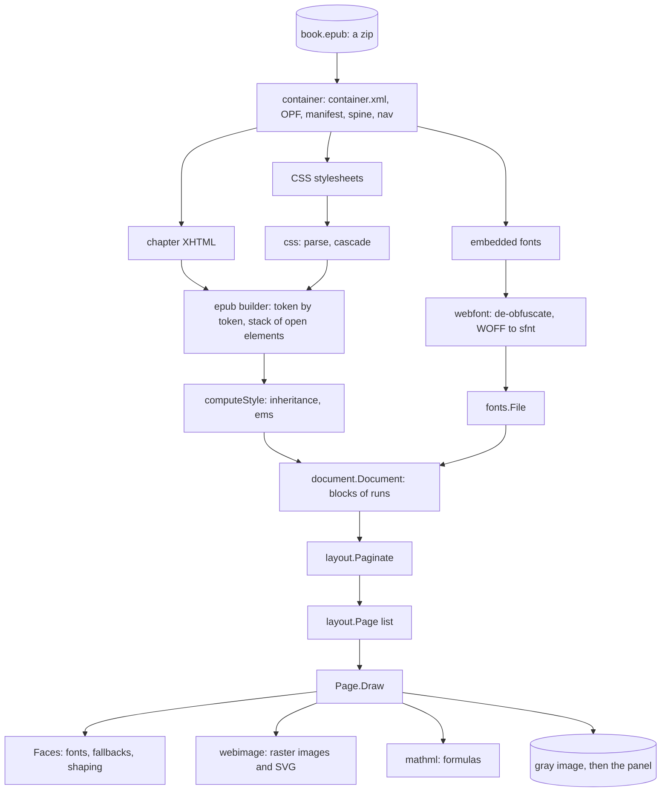

# From an EPUB to pixels

An EPUB is a zip of small web pages. A browser would show it with an HTML parser, a CSS
engine, a layout engine and a font stack. Inkshelf has none of those available on the reader,
so it carries a small version of each, limited to what books use. This page follows one
chapter from the zip file to the pixels on the panel, and says which package does each step.

The packages, from the bottom up:

| Step | Package |
|---|---|
| Open the zip, read the package document and navigation | [internal/ebook/epub/container](../../internal/ebook/epub/container) |
| Parse CSS, match selectors, run the cascade | [internal/web/css](../../internal/web/css) |
| XHTML + CSS → document | [internal/ebook/epub](../../internal/ebook/epub) |
| The document model | [internal/typesetting/document](../../internal/typesetting/document) |
| Lines, pages, drawing | [internal/typesetting/layout](../../internal/typesetting/layout) |
| Fonts | [internal/graphics/fonts](../../internal/graphics/fonts), [internal/web/webfont](../../internal/web/webfont) |
| Images | [internal/web/webimage](../../internal/web/webimage), [internal/web/svgimage](../../internal/web/svgimage), [internal/graphics/pageimage](../../internal/graphics/pageimage) |
| Formulas | [internal/web/mathml](../../internal/web/mathml) |
| Fixed-layout pages | [internal/ebook/fixedlayout](../../internal/ebook/fixedlayout) |
| Turning pages, links, table of contents | [internal/reading](../../internal/reading) |

## 1. The container

The zip follows the Open Container Format. `META-INF/container.xml` names the *package
document* (the `.opf` file), which has three parts that matter:

- the **metadata**: title, language, identifiers, and whether the book is reflowable or
  fixed-layout (`rendition:layout`);
- the **manifest**: every file of the book, by id, with its media type. An item the app cannot
  show (a scripted page, an AVIF image) may name a *fallback* item to show instead;
- the **spine**: the reading order. Its *linear* items are the chapters; the others (notes,
  answers) are shown only when a link leads to them.

The **navigation document** (EPUB 3) or the **NCX** (EPUB 2) holds the table of contents, the
printed page list and landmarks. `container.Book` reads all of this once.

`META-INF/encryption.xml` lists encrypted files. A book with DRM is refused with `ErrDRM`.
Books that only *obfuscate* their fonts are fine: see Fonts below.

All paths are paths inside the zip. A link in a file is relative to that file, and
[internal/web/uri](../../internal/web/uri) resolves it.

## 2. XHTML and CSS into a document

`epub.Book.Chapter(index)` builds one chapter (`chapter.go`, `build*.go`):

- A **builder** reads the XHTML as a stream of tokens, keeping the open elements on a stack.
- Each element's **declared values** come from a `css.Cascade`: the user agent stylesheet
  (`userAgentCSS` in `style.go`, the defaults such as "h1 is bold and large") first, then the
  book's `<link>`ed sheets, `<style>` blocks and `style` attributes. The cascade decides which
  declaration wins: `!important`, then the more specific selector, then the later rule.
- CSS selectors only look at an element, its ancestors and its *previous* siblings. That is
  what lets the builder style an element the moment it opens, without the whole tree. Selectors
  that need later siblings (`:last-child`, `:empty`) are dropped.
- `computeStyle` turns declared values into **computed values**: it applies inheritance (a
  `` inside an italic `
` is italic) and converts lengths to hundredths of an em.
- Text is gathered into **runs** of one style, whitespace collapsed as HTML does. A block
  element (`
`, `<h1>`, `<li>`) ends the current **block** and starts another.

Some elements produce more than plain blocks: a border or background becomes a border box, a
CSS float a float group, a `<table>` a grid of cells, `epub:type="footnote"` (or a link back to
its call) marks a footnote. [document-model.md](document-model.md) describes the result.

## 3. Layout and drawing

`layout.Paginate(doc, settings, faces, sizer)` breaks the document into `Page`s for a screen
size, margins and font size. Each `Page` holds words, images, rules and links at their pixel
positions. `Page.Draw` then draws a page into a gray image. [pagination.md](pagination.md)
explains the layout.

[internal/reading](../../internal/reading) is the caller while reading: it lays out the current
chapter and its neighbours, keeps their pages, and draws the page shown.

## Fonts

A book may embed fonts with `@font-face`. They arrive in three formats: plain TrueType or
OpenType (*sfnt*), WOFF (each table zlib-compressed) and WOFF2 (Brotli-compressed, some tables
transformed). Publishers often *obfuscate* them: the first bytes are XORed with a key derived
from the book's identifier. `container.Book.Font` loads each font once: `webfont.Deobfuscate`
(trying each identifier, then `webfont.RecoverAdobe`), `webfont.ToSFNT`, then `fonts.Parse`.

`layout.Faces` opens fonts when layout first needs them: the book's embedded families, the
generic `serif`/`sans-serif`/`monospace`, and the reader's typeface (the firmware's Liberation
and DejaVu fonts, else Go's fonts compiled in).

No font has every character. When a font lacks one, `Faces` draws that character with a
**fallback** (`fonts.OpenFallbacks`: DejaVu Sans, then Go's). A word its own font covers costs
nothing extra.

Latin text is drawn one glyph per character. Arabic letters change shape with their neighbours,
Hebrew stacks points, and so on. For those scripts `fonts.Font.Shape` runs **shaping** with
go-text's pure-Go port of HarfBuzz, and only for text that needs it.

## Images

The document stores an image by its path in the zip, or as a `data:` URI. At draw time,
`webimage.NewLoader` reads the file and prepares it at the size the layout gave it:

- a raster image (JPEG, PNG, GIF, BMP, WebP, JPEG XL) through `pageimage.Prepare`, the same
  stages as comic pages ([image-pipeline.md](image-pipeline.md));
- an SVG through `svgimage.Rasterize`: it runs a small CSS cascade on the SVG, hands shapes to
  `github.com/srwiley/oksvg`, and draws the SVG's `<text>` with the book's `Faces` (through
  `Faces.SVGText`).

An inline `<svg>` in the XHTML becomes an image whose path is a `data:image/svg+xml` URI of its
markup, styled by the chapter's CSS first. Layout only needs an image's size, which
`epub.Book.ImageSize` reads from the file's header without decoding it.

## Formulas

A `<math>` element is read by `mathml.Read` into a tree of nodes. It cannot be laid out yet:
its size depends on the text's font size, which is only known at layout time. So the builder
stores it as an *image* whose path is `mathml:` followed by its markup (`mathml.Path`).
When layout meets such a path (`mathml.Is`), it lays the formula out with `mathml.Layout` at
the size of the surrounding text, using the serif fonts of `Faces`, and places it on the line's
baseline. Formulas past mathml's size limits fall back to the book's `altimg`, then its
`alttext`.

## Fixed-layout pages

Some books (comics, children's books) are *pre-paginated*: each spine item is one page designed
at a fixed size, its elements placed with `position: absolute`. Text flowing around would make
no sense, so these chapters take another route:

- The builder, given a `fixedlayout.Page`, makes a `Region` of each positioned element and of
  each background; the page's size comes from its viewport `<meta>`.
- `Page.Render` draws the regions, scaled to the screen: backgrounds (color, linear gradient,
  image), then each region's content (a lone image fitted, or text laid out by `layout` inside
  the region).
- A book whose chapters are all fixed-layout (`Book.FixedLayout`) is drawn page by page at
  download time (`Book.RenderPage`), prepared as `.pg4` pages, and then read like a comic.
- In a *mixed* book, a fixed-layout chapter's document is one image block whose path is
  `rendered-page:` followed by the item's path. `Book.Resource` recognizes the prefix and draws
  the page as a PNG at 1404×1872 when the image loader asks for it.

## The index and rune offsets

Laying out a whole book at the reader's font size takes seconds. But the app needs the book's
length for progress, and where each table-of-contents entry leads, as soon as the book opens.

`epub.BuildIndex` reads every chapter once, at download time, without fonts, and saves an
`Index` as `index.json` next to the book: each chapter's length, the table of contents, page
list and landmarks (each as a chapter and an offset), the language and page progression.
`IndexVersion` is bumped when the index changes; `shelf.Store.LoadIndex` rebuilds a stale one.

Every position is a **rune offset** in its chapter's document: a count of characters, an image
or a rule counting as one. Offsets come from the document, not the layout, so they never
depend on the font size or the screen. A reading position is saved as a chapter and the offset
of the page's first rune (`shelf.Location`). After a font size change, the reader lays the
chapter out again and opens the page that holds that offset (`layout.PageAt`). For the lists
and progress sync, a book also has virtual pages of `shelf.CharsPerPage` (1500) runes.
