# The image pipeline

A manga or comic page arrives from the server as a JPEG, PNG, WebP or JPEG XL, often in color
and larger than the screen. The panel shows 1404×1872 pixels in 16 grays, and e-ink renders mid
grays lighter than a computer screen. Every page must be converted to the panel's terms.

That conversion is slow on the reader's ARM processor: decoding a large JPEG alone takes a
noticeable fraction of a second. So it happens **once, at download time**, and the result is
saved as a small raw file. Turning a page then only reads that file, unpacks it and copies it
to the screen.

The stages are in [internal/graphics/pageimage](../../internal/graphics/pageimage); the download
that drives them is in [internal/shelf](../../internal/shelf).

## Overview

```mermaid
flowchart LR
    server["Server: Komga, Calibre-Web CBZ, Mealie"] --> fetch["fetchers x3"]
    fetch --> queue[["small queue"]]
    queue --> prepare["preparers, one per core"]
    subgraph Prepare["pageimage.Prepare"]
        decode["DecodeGray: decode to gray, over white"] --> fit["fit: box filter to screen size, histogram"]
        fit --> tone["toneTable: stretch, 0.5% clip, gamma 1.8"]
        tone --> dither["ditherAndPack: Floyd-Steinberg to 16 grays"]
    end
    prepare --> decode
    dither --> file[("NNNN.pg4 on disk")]
    file --> unpack["Unpack at page turn"]
    unpack --> draw["pocketbook.DrawImage, then Refresh"]
```

## Downloading: two groups of workers

`Store.Download` (`internal/shelf/download.go`) runs two groups of goroutines joined by a
small channel:

- **Fetchers** (`fetchWorkers`, 3) ask the server for pages. More parallel requests only slow
  Komga down.
- **Preparers** (`prepareWorkers`: one per core, at least 2, at most 8 because each holds a
  decoded page of 20–40 MB) run `pageimage.Prepare` and write the `.pg4` file.

The channel between them holds only a couple of pages, so memory stays bounded. Progress is
reported from a goroutine of its own: a UI repaint, which waits for the panel, never holds up
the workers.

A CBZ (a zip of images) is fetched whole first, then its pages go through the same preparers.
A fixed-layout EPUB is drawn page by page and prepared with `PrepareDecoded` (see
[epub-to-page.md](epub-to-page.md#fixed-layout-pages)). Covers for the lists go through
`Prepare` too.

Every file is written to a temporary file and renamed (`write_atomic.go`), and `book.json` is
written last. A book folder without `book.json` is an interrupted download: the next
`Download` resumes it, skipping the pages already on disk.

## The stages

### 1. Decode to gray

`DecodeGray` (`decode.go`) uses the standard library's JPEG and PNG decoders,
`golang.org/x/image/webp`, and `github.com/gen2brain/jxl` for JPEG XL, all pure Go.
(The firmware's libjpeg-turbo was 5–10× faster but needs cgo.)

`toGray` has a fast path for each image type the decoders return. For a JPEG, the decoder
already stores brightness (the Y plane of YCbCr) separately from color: that plane *is* the
gray image, taken as is. RGBA pixels are converted directly, never through the slow `img.At`.

Transparent pixels are often stored black. Shown as is, a transparent PNG would come out as a
black page, so transparency is composited over white, the paper. A row is first converted as if
opaque, and converted again only if one of its pixels is not.

A JPEG XL image's header can ask for any size, so one above `maxJXLPixels` (8.4 Mpx) is
refused before decoding, and the decoder's panics are recovered. That is why the app decodes
images through `pageimage.Decode` rather than `image.Decode`.

### 2. Fit to the screen

`fit` (`fit.go`) scales the image down to fit the screen, keeping its aspect ratio, with a box
filter: each output pixel is the average of the source pixels it covers. Averaging keeps thin
ink lines visible, where picking one source pixel would drop some. While it writes the
result, `fit` also counts how many pixels have each gray: the *histogram*.

### 3. Tone table

Scans are often "gray on gray": yellowed paper and faded ink. `toneTable` (`tone.go`) builds a
256-entry lookup table from the histogram:

- It stretches the grays so that the darkest 0.5% become black and the lightest 0.5% white.
  Clipping a small share means one black speck cannot keep the paper from turning white.
- It applies a gamma of 1.8, which darkens mid grays to make up for e-ink rendering them light.

A table makes the per-pixel work of the next stage a single lookup.

### 4. Dither and pack

The panel has 16 grays. Rounding every pixel to the nearest one would band smooth shading.
*Floyd–Steinberg dithering* rounds each pixel, then spreads its rounding error to the
neighbours not yet visited (7/16 right, 3/16, 5/16, 1/16 on the next row), so that areas keep
their average gray. `ditherAndPack` (`dither.go`) does this for gray only, much faster than
`image/draw.FloydSteinberg`, and writes each result straight into the output.

### The .pg4 format

A `.pg4` file (`pg4.go`) is the panel's own format: a 4-byte magic `PG4\x01`, the width and
height as little-endian uint16, then the rows, two pixels per byte (left pixel in the high 4
bits). It is half the size of an 8-bit image, and reading it needs no decoder. Books
downloaded by old versions have `NNNN.png` pages instead; `Store.LoadPage` still reads them.

## Reading a page back

At a page turn, `Store.LoadPage` reads `NNNN.pg4` and `pageimage.Unpack` expands it with a
256-entry table that maps one packed byte to its two grays. The app then copies the image into
the canvas with `pocketbook.DrawImage` and refreshes the panel (see
[eink-and-firmware.md](eink-and-firmware.md)). The app also decodes the next and previous
pages ahead of time, so most turns only draw.

## Images inside EPUBs

Images in EPUB text are not prepared at download time: their size depends on the layout.
[internal/web/webimage](../../internal/web/webimage) runs the same `Prepare` (or `svgimage` then
`PrepareDecoded` for an SVG) when a page is drawn, at the size the layout gave the image.

## Hot paths

A few functions run on every page of every download or on every page turn, and their speed is
visible on the reader:

| Function | File | Benchmark |
|---|---|---|
| `fit` | `pageimage/fit.go` | `BenchmarkFitDither` |
| `ditherAndPack` | `pageimage/dither.go` | `BenchmarkFitDither` |
| `rgbaToGray` | `pageimage/decode.go` | `BenchmarkRGBAToGray` |
| `Unpack` | `pageimage/pg4.go` | `BenchmarkUnpack` |
| `copyRotated` | `device/pocketbook/framebuffer_copy.go` | `BenchmarkCopyRotated` |
| the glyph drawing | `graphics/fonts/draw.go` | `BenchmarkDrawString` |

Each is marked `HOT PATH` in its comment. They were tuned by reading the ARM assembly, so the
rules for changing one are:

1. Run its benchmark before and after (`go test -bench FitDither ./internal/graphics/pageimage`),
   and compare with `benchstat`. A change must not make it slower.
2. Check that the helpers it relies on are still inlined *for ARM*, where the compiler's
   budget differs from your laptop's:
   `GOOS=linux GOARCH=arm GOARM=7 go build -gcflags=-m ./internal/graphics/pageimage 2>&1 | grep inline`.
   Compare the list before and after. For `copyRotated`, also look at `-gcflags=-S`.
3. `fit` must still match `fitRef` in `fit_test.go`, a plain version of the same box filter.

Code in these functions is shaped for the compiler: slices re-sliced so bounds checks
disappear, helpers small enough to inline, work moved out of the per-pixel loop. Keep that
shape, and keep the comment explaining it. Spans ([profiling.md](profiling.md)) go around these
functions' callers, never inside them.
