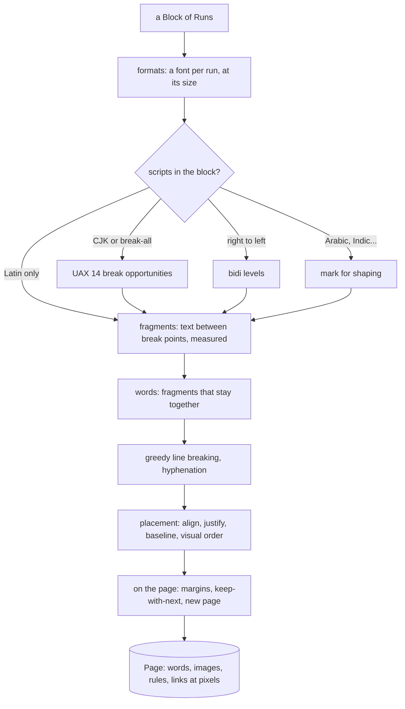
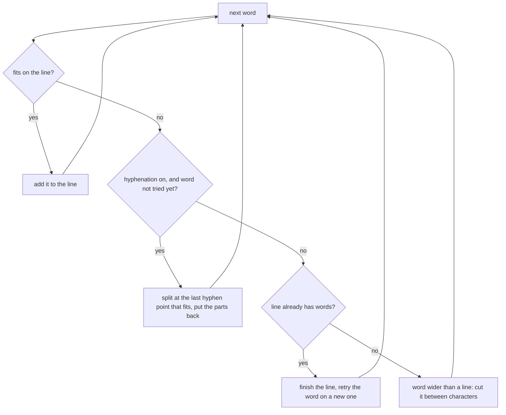

# Pagination: from blocks to pages

[internal/typesetting/layout](../../internal/typesetting/layout) turns a
[document](document-model.md) into pages for the reader's screen. It does the job of a
browser's layout engine for the parts of CSS that books use. The entry point is

```go
pages, err := layout.Paginate(doc, settings, faces, imageSizer)
```

`Settings` give the page size, margins, font size, line spacing and whether to justify;
`Faces` open the fonts; the `ImageSizer` gives an image's size without decoding it. The result
is a list of `Page`s, each holding words, images, rules, strokes (underlines) and links at their
pixel positions, and the rune offsets it shows (`Start`, `End`). `Page.Draw` draws one.



The code follows these steps in order: `text_preparation.go`, `fragments.go`,
`line_breaking.go`, `line_placement.go`, then `paginate.go`, with floats, tables and border
boxes in files of their own.

## 1. Preparing a block's text

Each run gets a *format*: its font opened at its size, its color, its link, its inline image
sized to fit (`makeFormats`). Then the scripts of the text decide what else is needed. Each of
these is costly, and Latin text needs none of them, so `Block.Scripts` (scanned once when the
document was built) lets most blocks skip them all:

- **Break opportunities.** Chinese and Japanese have no spaces: a line may break between most
  ideographs, but not before a closing bracket or a small kana. The Unicode line breaking
  algorithm (UAX #14, through `github.com/rivo/uniseg`) finds where (`break_opportunities.go`).
  Alphabetic text breaks only at spaces and dashes.
- **Bidirectional levels.** Hebrew and Arabic run right to left, and may hold numbers or Latin
  words that run left to right. The Unicode bidirectional algorithm (`bidi.go`) gives each
  character a *level*: even levels run left to right, odd ones right to left.
- **Shaping.** Scripts whose letters join or combine are measured and drawn as glyphs shaped by
  the font (see [epub-to-page.md](epub-to-page.md#fonts)).

## 2. Fragments and words

The text is cut at every point where a line may break into **fragments** (`fragments.go`):
stretches of text with no break inside, in one format, each measured once. What follows a
fragment is its *break kind*: a space (stretchable), a soft hyphen U+00AD (draws a hyphen if
the line breaks there), or a direct break after a dash, a zero-width space or an ideograph. A
no-break space never breaks.

Consecutive fragments with no break between them form a **word**, the smallest thing a line may
hold. A word is usually one fragment; "un*believ*able" is three, in two styles.

## 3. Line breaking

Lines are filled **greedily**: words go on the line until the next one does not fit, then a new
line starts (`breakLines` in `line_breaking.go`). Greedy breaking is what browsers do. It is
fast and its result never changes earlier lines, which matters on a slow processor.



**Hyphenation** uses [internal/typesetting/hyphen](../../internal/typesetting/hyphen): Liang's
algorithm, the one TeX uses, with patterns for a few languages. It runs only for a word that
does not fit, so most words are never hyphenated or even looked up. A line ending at a soft
hyphen draws a hyphen; if that hyphen does not fit, the last word moves to the next line.

## 4. Placing a line

`line_placement.go` places each line's words:

- **Alignment**: left, right, centred, or justified. *Justification* spreads the room left over
  the line's stretchable gaps (spaces, and the breaks next to ideographs). The last line of a
  justified paragraph aligns at the start, as in print, unless `AlignLast` says otherwise. In a
  right-to-left block, "start" is the right and the first-line indent is on the right.
- **Height and baseline**: all words of a line share one baseline. A line is as high as its
  largest font, inline image, emphasis marks or formula.
- **Visual order**: with bidi levels, the line's fragments are reordered for display (rule L2
  of the bidi algorithm). Offsets keep the logical order.
- Underlines and strikes become `Stroke`s, continuous across a run; links become tap
  rectangles, merged per line.

## 5. Pages

`paginate.go` stacks blocks down the page, keeping a cursor `y`:

- **Margins collapse**, as in CSS: between two blocks the larger of the two margins is used,
  not their sum. A block at the top of a page has no top margin.
- **A new page starts** when the next line does not fit, or when a block has `PageBreak`.
- **Orphans and headings**: a paragraph keeps its first two lines together, so no page ends
  with a lone first line. A heading (`KeepWithNext`) moves to the next page unless two lines of
  the following block fit after it.
- **Images** are fitted in the page, enlarged at most three times.
- Anything that does not fit on an *empty* page goes there anyway: the next page would be no
  better.

## Floats

A float group (a picture with its caption, a sidebar) is laid out **apart**, in its own width,
then placed at its side where the next block starts (`floats.go`). The lines of the following
blocks are laid out again, shorter, while they are beside it. Several floats stack. A float
that does not fit on the rest of the page waits for the next page while the text goes on. One
wider than 60% of the text, or on a page too narrow for text beside it, stays in the text as
ordinary blocks. A floated letter much larger than its paragraph is a **drop cap**: it sits on
the baseline of one of the paragraph's first lines.

## Tables

A table is laid out as a grid (`tables.go`, `table_columns.go`, `table_rows.go`):

1. **Columns**: each cell's content is measured at its narrowest (its longest word) and widest
   (all on one line). Widths the book asks for are tried first. A table too wide shrinks its
   font, down to 60% of the text's, then squeezes its columns.
2. **Cells**: each cell is laid out unjustified in its column's width.
3. **Rows** are placed in *bands*: rows that no cell spans out of. A band that fits is kept whole
   on a page. A band too tall for a page is cut between the lines of its cells. On each page the
   table continues on, its header rows are repeated on top (if they take a quarter of the page
   at most).

## Border boxes across pages

A border box (a sidebar, a boxed note) is drawn under its blocks (`border_boxes.go`). When the
page ends inside a box, it is *broken*: drawn to the page's bottom without its bottom border,
then *restarted* at the next page's top without its top border. A box whose first part would
hold nothing moves to the next page whole, rather than leaving a lone top border at the
bottom of a page. Margins collapse through a box that has no border or padding on that side.

## Child paginators

Floats and table cells need a layout of their own, in another width. Rather than a separate
engine, the `paginator` creates a **child paginator** with adjusted settings and lets it place
the blocks with the same code:

- `layOutApart` lays a float group out on a page of the float's width;
- `cellPaginator` lays a cell out on one endlessly tall page, recording each line, image or
  rule it places as a `contentUnit`, so that a row can later be cut between units.

The parent then copies the child's result onto its own page, moved to where it goes. A table
in a cell is laid out by the cell's paginator, so nesting works the same way.
