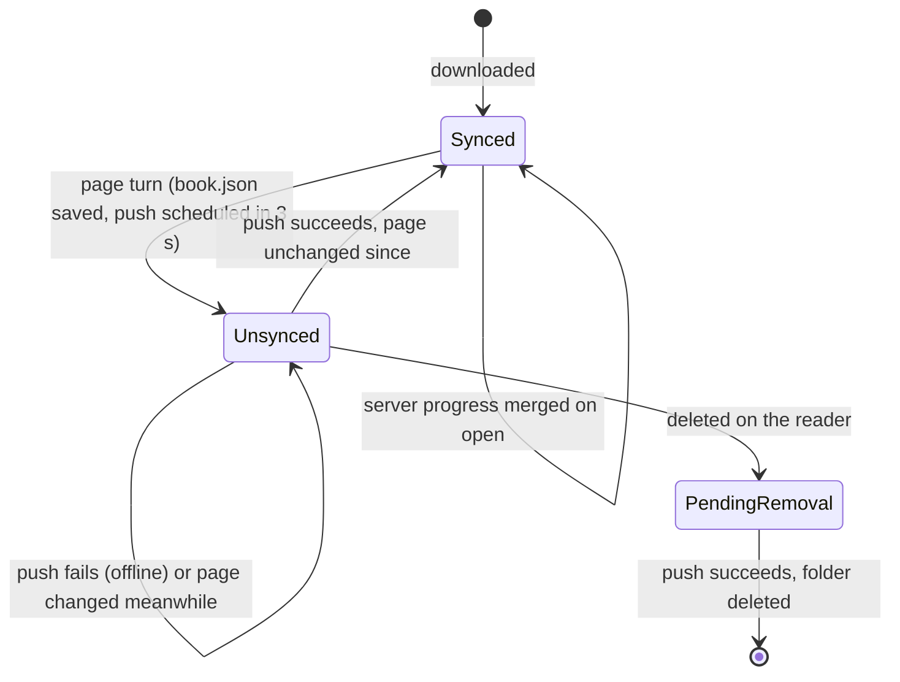

# Progress sync

Someone reads a book on the reader, then on a phone, then on the reader again. Each device
should open the book where it was left last, wherever that was. And the reader often has no
network. [internal/progress](../../internal/progress) handles this; the app calls it from
[app/openbook](../../internal/app/openbook), [app/catalog](../../internal/app/catalog) and
[app/session](../../internal/app/session).

## The progress of a book

A downloaded book's progress is in its `book.json` ([shelf](../../internal/shelf) `Book`):

- `Page`: the last page read, from 1, and `Completed`.
- `Unsynced` (saved as `"dirty"`): the server has not been told about this progress yet.
- `PendingRemoval` (saved as `"remove"`): the book was deleted on the reader, but its folder
  stays until its progress is sent.

The server's progress is a `servers.ReadingProgress`: a page and whether the book is completed.

## Sending: the Syncer

Every page turn saves the page in the app's state, sets `Unsynced`, and calls
`Syncer.Schedule(3 s)` (`openbook.SyncDelay`). Each call restarts the timer, so paging through
ten pages sends the progress once, 3 seconds after the last turn. The preloader goroutine saves
`book.json` to disk meanwhile.

`Syncer.PushNow` reads every book of the store, sends those that are `Unsynced`, and then:

- clears `Unsynced` and saves `book.json`, unless the page changed while the request was out
  (then the server is still behind, and the next push sends the new page);
- deletes the folder of a book `PendingRemoval`.

It stops at the first error: the reader is probably offline, and the next push retries.

Pushes also happen when a book is closed, when the app closes, when the firmware asks the app to
save its state or the reader is plugged in over USB, when the network comes back, and after the
series list loads (for what was read offline).

## Receiving: Merge

When a book opens online, the book list holds the server's progress, read with the books.
`progress.Merge(local, remote, fromServer)` decides who wins:

- The **server wins** when `fromServer` is true (the progress was just read from a server that
  keeps progress) and the local book is not `Unsynced`: another device may have read further, or
  gone back.
- The **reader wins** when it has progress the server has not seen (`Unsynced`), or when the app
  is offline.

The lists follow the same rule: a downloaded book that is `Unsynced` shows the reader's page, and
the series list's "Continue" row shows the book read last on the reader when it is ahead.

## Offline

Without the server, the app lists the downloaded books from the store
(`catalog.AddDownloadedSeriesLocked`) and their progress comes from `book.json`. Pages turned
offline stay `Unsynced`, and the push after the next successful series load sends them. While
the reader is not connected, the Syncer does not try at all (`session.NewSyncer` gives it no
server): every request would fail at once, and only fill the log. `NetConnected` schedules a
push when the network comes back.

## Servers without progress

Mealie and Calibre-Web (over OPDS) keep no reading progress. Their `InProgress`, `SetProgress`
and `ClearProgress` return an error wrapping `errors.ErrUnsupported`. Then:

- The app sets `Server.LocalProgress`: the reader's progress wins everywhere, and the series'
  read counts come from the store.
- `Merge` is called with `fromServer` false, so nothing is overwritten.
- A push that gets `ErrUnsupported` counts as a success, so books do not stay `Unsynced` forever.

## EPUBs: locations and virtual pages

An EPUB whose text flows (a `Reflowable` book) has no fixed pages: how many there are depends on
the font size. Its real position is a `shelf.Location`, saved in `book.json` as `"location"`:

- `Chapter`: the spine item, from 0.
- `Offset`: the rune offset of the first character on the page, from the chapter's start.

Rune offsets never change with the layout, so the reader finds the same text after A+ or A−.

For everything else (the lists, the server, the progress bar), the book also has **virtual
pages** of `shelf.CharsPerPage` (1500) runes. `Page` and `Pages` count those, so the sync, the
auto-download of the next book at 80% and the lists work as for a comic. The lists show them as
"~N pages" and "At n%".
